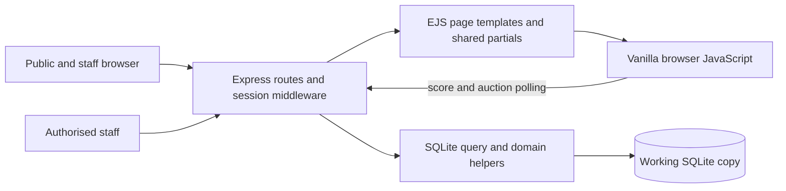

# SPL JavaScript Architecture

## Current implementation

The rebuild is a server-rendered modular monolith using Node.js, Express 5, EJS, browser JavaScript, CSS, and the Node built-in SQLite driver. It preserves the earlier requirement to keep the delivered app in JavaScript; the Django source archive is a read-only reference.

## Main code areas

- `app.js` contains route registration, request validation, authentication gates, match scoring actions, contact persistence, and auction actions. It is currently a single large module.
- `db.js` wraps synchronous `node:sqlite` queries and maps the existing league records to view data. Schema changes live in numbered JavaScript migrations under `scripts/migrations/`.
- `views/pages/` contains public pages and organiser screens; `views/partials/` contains the shared header, footer, score, team, and player components.
- `public/static/css/site.css` reuses the archived stylesheet with responsive and feature-specific additions. `extensions.css` contains styles for the new auction, analytics, and staff pages. `public/static/js/site.js` handles navigation, filters, show-more controls, polling, and service-worker registration.
- `data/db.sqlite3` is the separate working copy. It is not the source archive database.

## Audit findings

- Route registration remains in `app.js`, with transactional scoring and auction rules in `db.js`; a future cleanup could further separate route modules and domain services.
- SQLite access is synchronous, which is simple for the supplied dataset but blocks the event loop during larger queries and cannot provide PostgreSQL row locks for concurrent bids.
- Numbered migrations run transactionally, create a verified backup before applying, record applied versions, and protect rollback with checks. Migration checks run on disposable database copies.
- Sessions use a persistent SQLite session store. Production startup requires an explicitly configured `SESSION_SECRET` with at least 32 characters; login attempts are throttled and baseline security headers are set.
- Explicit super-admin, organiser, auctioneer, scorer, team-owner, player, and spectator roles are supported. Existing staff/superuser accounts map to compatibility permissions; super-admin role assignment and team-owner isolation are implemented.
- Live scores and auction pages poll the server. Scoring and bids have transactional validation, unique idempotency keys, and audit events; a bid-timer, bid correction/reversal, and websocket delivery are not implemented.
- The archive has historical score summaries and player statistics but no usable historical delivery stream for every match. Missing ball-by-ball history must remain unavailable rather than be synthesized.
- The database references player, team, and sponsor images that are absent from the supplied archive and project assets.
- The current locked production dependency set returned zero advisories in `npm audit --omit=dev` on 2026-11-24. Re-run the audit after dependency updates; this is not a guarantee about future releases or the full hosting environment.

## Baseline checks

- `npm test` runs built-in `node:test` checks for readiness, public pages and details, player analytics, auth role gates, account creation, and team-owner bid isolation/idempotency. It uses an isolated copy of the league database.
- `npm run test:migrations` checks backup integrity and row counts, foreign-key integrity, migration application, and a safe rollback on a disposable copy.
- Tests cover the high-risk transactional paths implemented here, but do not model high-volume concurrent writers, live hosting, full accessibility, or all staff form combinations.
- A verified database snapshot is recorded in `DATABASE.md` before future schema migrations.

## Target architecture decisions

- Keep the JavaScript stack already requested for `spl-js`; do not reintroduce Django or Python.
- Stage domain services and validators inside the monolith before introducing separate processes.
- Keep SQLite as this deliverable's authoritative store as requested. A PostgreSQL cutover is a separate project requiring an approved migration, staging instance, and reconciliation of IDs, relationships, and critical aggregates.
- Use WebSockets only after the database transaction model is in place; broadcast state after commit and retain database-backed snapshots for reconnects.
- Keep Redis optional for delivery and caching. It must not become the permanent source of auction or match state.
